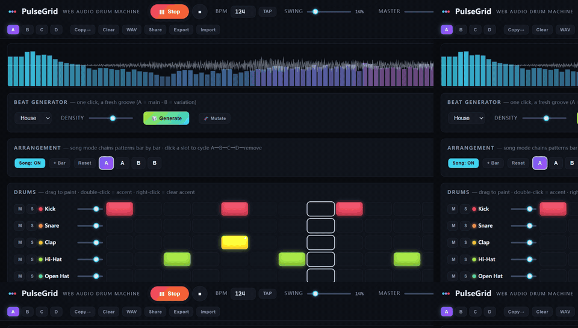
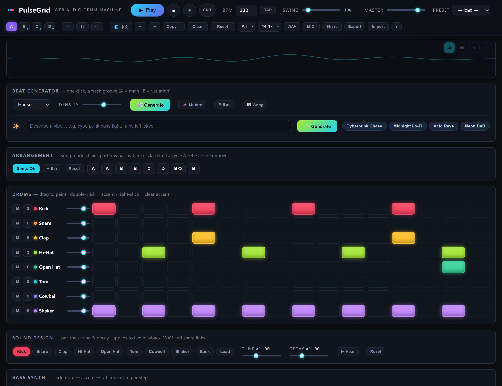

# 🥁 PulseGrid

**A browser drum machine & bass-line sequencer with zero dependencies and zero build steps. Every sound is synthesized in real time with the Web Audio API — no samples, no assets, no framework.**





[](../../actions/workflows/ci.yml)
[](LICENSE)
[]()
[]()
[]()

## ✨ Features

- **🎲 Beat Generator** — rule-based grooves in five styles (House, Hip-Hop, Techno, Breaks, Surprise) with a density control; one click fills A with a main groove and B with a mutation of it, 🧬 **Mutate** evolves the active pattern in place
- **Song mode** — chain patterns bar-by-bar (up to 16 bars) and the transport plays the arrangement; the grid auto-follows whatever bar is playing
- **8 synthesized drum voices** — kick, snare, clap, closed/open hi-hat, tom, cowbell, shaker — each built from oscillators and shaped noise, 808-style, with authentic **open-hat choking**; every drum cell supports **accents** (double-click) for velocity dynamics
- **Mono bass synth** with a chromatic piano roll (C2–C3), per-step accents and an enveloped resonant low-pass (acid squelch included), plus its own mute / solo / volume strip
- **Sample-accurate sequencing** via the lookahead scheduler pattern — timing never drifts, even when the main thread stutters, and playback keeps running steadily in **background tabs** (lookahead widens automatically when the tab is hidden)
- **Swing** from straight to lazy, applied at scheduling time
- **4 pattern banks (A–D)** switchable live while the transport runs — by mouse or keys `1`–`4`
- **Master FX rack**: tempo-synced dotted-8th delay, convolution reverb (impulse response generated in code), master low-pass filter
- **Per-track mute / solo / volume** with de-zippered gain ramps
- **Genre presets**: House, Hip-Hop, Techno, Synthwave — each with a main groove and a variation
- **Real-time spectrum + waveform visualizer** on canvas
- **Sound Design panel** — per-drum **tune** and **decay** knobs with instant audition; sound design travels with live playback, WAV renders and share links
- **MIDI export** — standard `.mid` file (drums on GM channel 10, chromatic bass on channel 1); drop it straight into any DAW
- **WAV export** — renders your patterns (or the whole song chain) through an `OfflineAudioContext` using the exact same synthesis code, faster than real time
- **Share links** — one click encodes the whole project state into the URL (base64url in the hash); open the link and the beat is there
- **Autosave** to localStorage (flushed on tab hide/close), **export/import** patterns as JSON, destructive Clear guarded by a two-step confirm
- Keyboard: `Space` = play/stop, `1`–`4` = pattern. Drag across step cells to paint.
- **PWA** — install it from the browser as a desktop/mobile app (icons generated by `tools/make-icons.js`, a hand-rolled PNG encoder on `node:zlib` — still zero dependencies); a cache-first service worker serves the whole app offline
- Works **fully offline** — system fonts, inline SVG favicon, no CDN, no fetch. Double-click `index.html` and it runs.

## 🚀 Quick start

```bash
git clone https://github.com/your-name/pulsegrid.git
cd pulsegrid
python -m http.server 8000     # or: npx serve
# open http://localhost:8000
```

No server? No problem — open `index.html` directly from your file manager. It works the same.

**Put it online:** push to GitHub, then in *Settings → Pages* set Source to **GitHub Actions** — the included workflow (`.github/workflows/deploy.yml`) deploys the site on every push to `main`.

## 🎛 How to play

1. Hit **🎲 Generate** — instant groove in A, variation in B (or pick a preset)
2. Press **Play** (or `Space`)
3. Toggle steps by clicking (or drag-painting); **double-click** a lit drum cell for an accent, right-click to clear it
4. Click bass-roll cells: once = note, twice = **accent**, three times = off
5. Turn on **Song** mode, chain A–D into bars with **+ Bar**, and let the arrangement play
6. Ride the **Filter** knob for builds, add **Delay/Reverb** for space; 🧬 **Mutate** nudges the current pattern somewhere new
7. Shape the kit itself in **Sound Design** — detune the kick, stretch the snare decay
8. Done? Hit **WAV** or **MIDI** to take the beat with you, or **Share** to copy a link that carries the whole project

## 🔊 Under the hood

All audio is synthesized at trigger time — the entire "sample library" is a few hundred lines of DSP:

| Voice | Recipe |
|---|---|
| Kick | Sine with exponential pitch drop 165→43 Hz + filtered noise beater click |
| Snare | Two pitch-dropping triangles (188/331 Hz) + band-passed noise crack |
| Clap | Band-passed noise with a 3-burst hand envelope |
| Hi-Hats | Six detuned square oscillators (808 ratios) → 10 kHz band-pass, short/long decay |
| Tom | Sine sweep 120→55 Hz |
| Cowbell | Two squares (540/800 Hz) through a band-pass |
| Shaker | High-passed noise with a soft attack ("tss") |
| Bass | Saw + sine sub → resonant low-pass with accent-driven envelope |

The sequencer uses the classic **lookahead technique**: a 25 ms `setInterval` schedules audio events ~120 ms ahead on the `AudioContext` clock, so playback is immune to main-thread jank; the UI playhead is driven by a timestamped queue consumed in `requestAnimationFrame`.

Patterns are authored in a tiny text DSL, which keeps presets readable:

```js
kick: P('x...x...x...x...')          // 'x' = hit, 'X' = accent, '.' = rest
bass: B([[2, 36, 1], [6, 36, 0]])    // [step, midi, accent]
```

The beat generator encodes each genre's conventions as rules (four-on-the-floor kicks for House, boom-bap templates for Hip-Hop, backbeats, hat grids, bass vocabulary) and rolls inside them with a seeded RNG — every 🎲 is random, but it always grooves.

## 📁 Project structure

```
pulsegrid/
├── index.html            # markup + script wiring (classic scripts, no bundler)
├── css/style.css         # dark studio theme
├── js/
│   ├── audio-engine.js   # synthesis voices, track strips, FX bus, master chain
│   ├── sequencer.js      # lookahead scheduler + swing + song mode + background tabs
│   ├── presets.js        # genre patterns + state model + text DSL
│   ├── generator.js      # rule-based beat generator + mutation
│   ├── midi.js           # standard MIDI file writer
│   ├── visualizer.js     # spectrum/waveform canvas
│   ├── render.js         # offline WAV rendering + PCM encoder
│   ├── ui.js             # grid, roll, song strip, generator, share links, persistence
│   └── app.js            # bootstrap + window.PG debug hook
├── test/run.js           # zero-dependency unit tests (vm harness, no framework)
├── tools/make-icons.js   # PWA icon generator (raw PNG encoding on node:zlib)
├── sw.js                 # cache-first service worker (full offline)
├── manifest.webmanifest  # installable-app manifest
├── icons/                # generated PWA icons
└── docs/screenshot-main.png
```

Open the console on a running instance and poke at it: `PG.seq.stop()`, `PG.state.bpm = 140`, `PG.engine.getLevel()`.

## 🗺 Roadmap

- [x] WAV export via `OfflineAudioContext`
- [x] Shareable URLs (pattern encoded in the hash)
- [x] Song mode (pattern chaining)
- [x] Rule-based beat generator + mutation
- [x] Per-step drum accents
- [x] Per-voice sound design (tune / decay)
- [x] MIDI file export
- [x] Zero-dependency test suite + CI (Node 18/20/22)
- [x] PWA install (manifest + service worker + generated icons)
- [ ] Browser E2E in CI

## 🤝 Contributing

Issues and PRs welcome. The codebase is deliberately small and dependency-free — please keep it that way. New presets are the easiest contribution: just add an entry to `PRESETS` in `js/presets.js`.

Run the test suite before opening a PR (no install step, no framework):

```bash
npm test        # or: node test/run.js
```

The suite covers the pure data layer — pattern DSL, generator rules, share codec, state normalization, MIDI/WAV byte formats. Audio-clock scheduling is verified by browser E2E.

## 📄 License

[MIT](LICENSE)

---

## 中文说明

**PulseGrid** 是一个纯 Web Audio API 实时合成的浏览器鼓机 + 贝斯音序器:零依赖、零构建、零采样,双击 `index.html` 即可运行。🎲 一键生成五种曲风的节拍(A 主 groove + B 变奏),🧬 变异按钮让节奏进化;鼓格支持重音、贝斯钢琴卷帘带重音、四组 Pattern 可编排成最多 16 小节的 Song 自动连播;Sound Design 面板可调每个鼓的音高与衰减;一键离线渲染 WAV、导出标准 MIDI(鼓走 10 通道、贝斯走 1 通道,直接拖进 DAW),或生成携带完整状态的分享链接。欢迎 Star / PR,新预设和新生成曲风都是很好的上手贡献。
